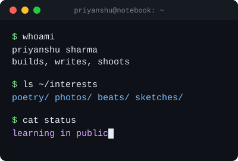
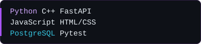

<h3></h3>

- [`CareerGap`](https://github.com/priyanshumakes/CareerGap) - compares a resume with a job description, lists the skill gaps, and suggests resources and project upgrades
- [`leetcode-solutions`](https://github.com/priyanshumakes/leetcode-solutions) - DSA practice in C++ and Python, brute force first, then optimized

<h3></h3>

