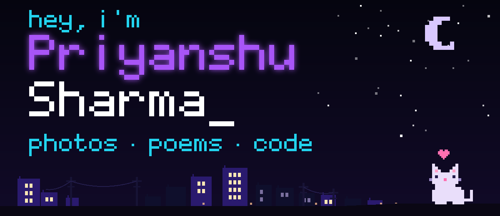

### projects/

- [`CareerGap`](https://github.com/heypriyanshu-sharma/CareerGap) - compares a resume with a job description, lists the skill gaps, and suggests resources and project upgrades
- [`leetcode-solutions`](https://github.com/heypriyanshu-sharma/leetcode-solutions) - DSA practice in C++ and Python, brute force first, then optimized

### tools/

```text
Python  C++  FastAPI
JavaScript  HTML/CSS
PostgreSQL  Pytest
```
